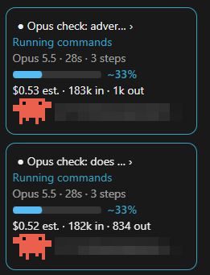

# claude-agent-monitor

A Claude Code mod that keeps a live pane of every subagent your session starts. Each running agent gets a card showing:

- **Model:** a plain name such as "Sonnet 5.5".
- **Task:** what it is doing right now (Researching, Writing, Verifying, Delegating, Done), with the file or command in progress.
- **Progress:** an estimated percent bar, drawn with a "~", and a rough time left such as "~2m left".
- **Cost:** estimated dollars and token counts.
- **A crab:** an 8-bit sprite that works while the agent works and raises its arms when it is done.

A one-line summary also appears above the prompt while any agent is running. Anything another plugin draws there (a usage bar, for example) stays beneath it.

## Screenshots

Two running agents as expanded cards, each with its model, estimated progress, estimated cost, token counts and current task:



Click an agent's name to open it: the other cards step aside, a breadcrumb shows where you are, and the detail view shows its task, model, progress, tokens, cost and recent steps:


### Works alongside other UI mods

The mod's one-line summary sits above whatever another plugin draws above the prompt instead of replacing it. Here it runs with a usage ribbon from RoboNuggets (7-day and 5-hour usage and a countdown badge); both stay visible:


## Using the pane

- **A stats row and a Running bar sit above the cards while any agent is running.** Three tiles show Total Cost (the session figure the engine keeps; when it can't be read the tile says "Total Cost (est.)" and shows the mod's own estimate), Total Tokens (input, cache and output, for the subagents in the pane only) and Total time (since the earliest running agent began, as `m:ss`). A green `▾ Running · N` bar sits above the running cards; click it to fold those cards away (`▸`) and again to show them. Finished cards stay visible either way. Both disappear when nothing is running.
- **Every agent is an expanded card**, running or finished, so you see them all at a glance. Past eight finished agents the rest collapse into "+N earlier finished".
- **Click an agent to open it like a folder.** The other cards step aside, the agent's own subagents take their place, and a breadcrumb at the top (`Agents › Scout the repo`) takes you back up. A `▸ 2` beside a name says it has two agents inside.
- **An opened agent shows its detail:** the task it was given, its model (name and id), agent type, effort and whether it runs in the background; its status, steps, time, message count and last stop reason; its tokens (input, cache read, cache write, output, and the size of its context now); its estimated cost split into input, cache and output; its last eight steps, one line each; and its final report once it finishes.
- **Clear finished** removes the cards of agents that are done, stopped or failed, and never one that is still going (pending, running or waiting). A finished parent that still has an agent going inside it stays too, so an opened folder and its breadcrumb never lose a card; the breadcrumb is cut back only if a card it names was cleared. The button shows how many it will clear, for example `Clear finished (3)`. When nothing can be cleared it is dimmed, and a note beside it says what stays, such as "2 still running stay".
- **The pane shows the latest prompt's work only.** When you send a new prompt, finished cards clear, except a finished parent that still has an agent going inside it. A running card the engine no longer lists as going clears too, so a missed end cannot leave one stuck (the Clear finished button leaves such a card alone, because it still says running; your next prompt removes it). A slash command or a background notification does not clear anything.
- **Statuses recover.** An agent that was done and works again (it was resumed) shows as running again, and a step from an agent the mod never saw start still gets a card. A resumed agent's time, steps and log start over, while its tokens and cost keep adding up.
- **In a terminal** the same cards draw as text, with `\o_o/` for the crab.

## Install

At the prompt of a terminal session:

```
/plugin install agent-monitor --marketplace luckyajinn/claude-agent-monitor
```

From a shell:

```
claude plugin install agent-monitor --marketplace luckyajinn/claude-agent-monitor
```

In the desktop app, where `/plugin` does not run: click + next to the prompt box, then Plugins, Add marketplace with `luckyajinn/claude-agent-monitor`, then Add plugin.

When asked `Add marketplace?`, answer `y`, then pick a scope. The pane opens by itself the first time a subagent starts, and `/agent-monitor` opens it any time.

## What is real and what is estimated

- **Progress is an estimate, drawn with a "~".** The engine has no percent-complete for an agent, and an agent's step limit is not in any event the mod receives. So the bar is a curve over steps taken: quick at first, flattening toward 95%, and 100% when the agent finishes.
- **Time left is a rough guess, not a promise.** It takes the pace of the agent so far, reads it against the progress curve above, and counts down between steps, so it is only as good as that curve. It stays hidden until the agent has taken 3 steps and run 20 seconds. It is rounded (to the nearest 30 seconds up to five minutes, then the nearest minute) and drawn with a "~". Near the flat end of the curve it says "finishing" instead of a number, and when the time is up or no step has landed for two minutes it says "taking longer than expected". A parent's time left covers its own work only, not its sub-agents. It shows on each running card and in an opened agent's detail view.
- **Cost is an estimate.** The engine reports token counts per agent but no dollars. They are multiplied by the rates below, which are assumptions. A model the table does not name uses the default rate and the card says "default rate". The pane also shows the session total the engine itself keeps.
- **Model, steps, tokens and activity are real.** They come straight from the engine's events.

## Privacy

Nothing is written to disk and nothing is sent anywhere. An agent's task text and final report are kept in memory inside the mod only, so a reload of the mod forgets them. The rest (names, status, activity lines with file names and commands, token counts and costs) lives in the session's plugin state, which other plugins in the same session can read.

## Cost rates

The dollar rates in [`hooks/track.ts`](hooks/track.ts) are my assumptions, not a price list, so edit them to match what you pay.

| Model family | Input, per million tokens | Output, per million tokens | Basis |
| --- | --- | --- | --- |
| Haiku | $1 | $5 | Assumed |
| Sonnet | $3 | $15 | Assumed |
| Opus | $5 | $25 | Assumed |
| Fable | $15 | $75 | Guess |

Cache reads are billed at 0.1 times the input rate and cache writes at 1.25 times. A model the table doesn't recognize uses the Sonnet rates. Change the `RATES` list at the top of `hooks/track.ts` and the pane picks it up on the next reload. A marketplace install is a cached copy, so an update to the mod will overwrite your edit.

## Development

The mod is one hooks module (`hooks/register.tsx`) plus helpers (`hooks/track.ts` for the state and numbers, `hooks/crab.ts` and `hooks/crabs.ts` for the sprite). A fresh clone cannot type-check until Claude Code has loaded the mod once, because `tsconfig.json` extends a file the engine writes. Run the tests and validation with:

```
claude plugin test .
claude plugin validate .
```

## Not affiliated with Anthropic

This is an unofficial community mod. The crab is a small pixel sprite inspired by the Claude Code mascot and is not official art.

## License

MIT, see [LICENSE](LICENSE).
