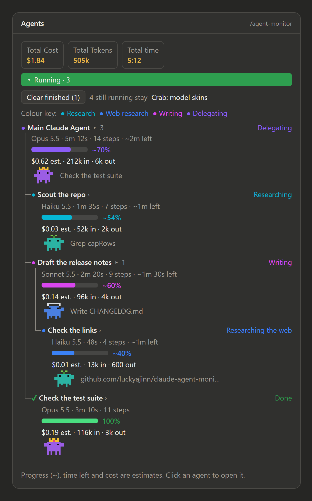
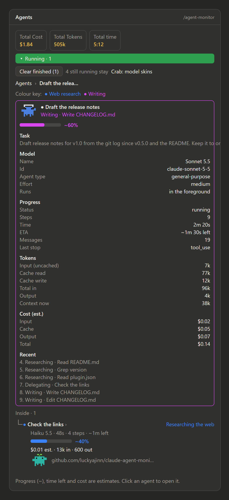
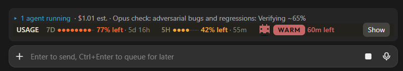

# claude-agent-monitor

A Claude Code mod that keeps a live pane of the main agent and every subagent your session starts, drawn as a tree. Each agent gets a card showing:

- **Model:** a plain name such as "Sonnet 5.5".
- **Task:** what it is doing right now (Researching, Writing, Verifying, Delegating, Done), with the file or command in progress.
- **Progress:** an estimated percent bar, drawn with a "~", and a rough time left such as "~2m left".
- **Cost:** estimated dollars and token counts.
- **A crab:** an 8-bit sprite that works while the agent works and raises its arms when it is done.

A one-line summary also appears above the prompt while any subagent is running (the main agent alone does not raise it). Anything another plugin draws there (a usage bar, for example) stays beneath it.

## Screenshots

The main agent at the root with its subagents as a tree: the stats row, the Running bar, the colour key, and each agent's model look, estimated progress and time left, estimated cost, token counts and current task:



Click an agent's name to open it: the other cards step aside, a breadcrumb shows where you are, the detail view shows its task, model, progress, tokens, cost and recent steps, and its own subagents hang beneath it:



### Works alongside other UI mods

The mod's one-line summary sits above whatever another plugin draws above the prompt instead of replacing it. Here it runs with a usage ribbon from RoboNuggets (7-day and 5-hour usage and a countdown badge); both stay visible:



## Using the pane

- **A stats row and a Running bar sit above the cards while any agent is running.** Three tiles show Total Cost (the session figure the engine keeps; when it can't be read the tile says "Total Cost (est.)" and shows the mod's own estimate), Total Tokens (input, cache and output, for the main agent and every subagent in the pane) and Total time (since the earliest running agent began, as `m:ss`). A green `▾ Running · N` bar (N is the running subagents) sits above the tree; click it to fold the subagents away under the main agent (`▸`) and again to show them. Both disappear when nothing is running.
- **A running card is coloured by the kind of work it is doing**, so agents doing similar work share a colour: research (cyan), web research (blue), writing (magenta), verifying (lime), commands (orange), delegating (violet) and other work (gray). The colour marks the card's status icon, its activity line, its progress bar and the line above the prompt, and a colour key lists the kinds on screen now. A finished card keeps its outcome colour (done green, failed red, stopped yellow). The activity stays written on every card, so nothing depends on colour alone.
- **The main agent is tracked too, at the root of a tree.** "Main Claude Agent" gets its own card (model, steps, tokens, cost, what it is doing) for the current prompt, and every subagent hangs beneath it with tree connectors (`├──`, `└──`, `│`); a subagent's own subagents hang one step further in. On the desktop the connectors are drawn as unbroken lines down the side of each card; in a terminal they are text. Siblings are listed in the order they started.
- **Every agent is an expanded card**, running or finished, so you see them all at a glance. In each group of siblings, past eight finished agents the earliest collapse into "+N earlier finished" (a finished one with an agent still going beneath it always stays).
- **Click an agent to open it like a folder.** The other cards step aside, its detail view takes the top and its own subagents hang beneath it as a tree, and a breadcrumb at the top (`Agents › Scout the repo`) takes you back up. A `▸ 2` beside a name says it has two agents inside.
- **An opened agent shows its detail:** the task it was given, its model (name and id), agent type, effort and whether it runs in the background; its status, steps, time, message count and last stop reason; its tokens (input, cache read, cache write, output, and the size of its context now); its estimated cost split into input, cache and output; its last eight steps, one line each; and its final report once it finishes.
- **Clear finished** removes the cards of agents that are done, stopped or failed, and never one that is still going (pending, running or waiting). A finished parent that still has an agent going inside it stays too, so an opened folder and its breadcrumb never lose a card; the breadcrumb is cut back only if a card it names was cleared. The button shows how many it will clear, for example `Clear finished (3)`. When nothing can be cleared it is dimmed, and a note beside it says what stays, such as "2 still running stay". It also clears a card stuck at running when the engine lists that agent as ended (its end was missed); a running card the engine does not list at all is kept until your next prompt, so a real agent is never cleared by mistake.
- **The pane shows the latest prompt's work only.** When you send a new prompt, the pane clears by the same rule as Clear finished: any agent the engine still lists as going stays (whatever its card says), with its parents, while a card stuck at running that the engine no longer lists goes, so a missed end cannot leave one stuck. The main agent's card starts fresh with the new prompt's turn, and stays from the last one only as the parent of something kept. A slash command or a background notification does not clear anything.
- **Statuses recover.** An agent that was done and works again (it was resumed) shows as running again, and a step from an agent the mod never saw start still gets a card. A resumed agent's time, steps and log start over, while its tokens and cost keep adding up.
- **The crab wears its model's look.** Haiku is a teal crab with a green sprout, Sonnet a blue crab in headphones, Opus a purple crab with a gold crown and Fable an amber crab in a wizard hat; an unknown model keeps the coral crab. The look follows the model the agent is using now, and in a terminal the variants are `\o.o/`, `\(o_o)/`, `\O_O/` and `\o~o/`. Prefer the classic crab? The `Crab: model skins` button in the pane switches every agent to the classic coral crab (`Crab: classic`) and back, for the current session. To make classic the default, turn off **Model crab skins** (`crabSkins`) for agent-monitor in `/config`.
- **In a terminal** the same cards draw as text, with `\o_o/` for the crab.

## Install

At the prompt of a terminal session:

```
/plugin install agent-monitor --marketplace luckyajinn/claude-agent-monitor
```

From a shell:

```
claude plugin install agent-monitor --marketplace luckyajinn/claude-agent-monitor
```

In the desktop app, where `/plugin` does not run: click + next to the prompt box, then Plugins, Add marketplace with `luckyajinn/claude-agent-monitor`, then Add plugin.

When asked `Add marketplace?`, answer `y`, then pick a scope. The pane opens by itself the first time a subagent starts, and `/agent-monitor` opens it any time.

## What is real and what is estimated

- **Progress is an estimate, drawn with a "~".** The engine has no percent-complete for an agent, and an agent's step limit is not in any event the mod receives. So the bar is a curve over steps taken: quick at first, flattening toward 95%, and 100% when the agent finishes.
- **Time left is a rough guess, not a promise.** It takes the pace of the agent so far, reads it against the progress curve above, and counts down between steps, so it is only as good as that curve. It stays hidden until the agent has taken 3 steps and run 20 seconds. It is rounded (to the nearest 30 seconds up to five minutes, then the nearest minute) and drawn with a "~". Near the flat end of the curve it says "finishing" instead of a number, and when the time is up or no step has landed for two minutes it says "taking longer than expected". A parent's time left covers its own work only, not its sub-agents. It shows on each running card and in an opened agent's detail view.
- **Cost is an estimate.** The engine reports token counts per agent but no dollars. They are multiplied by the rates below, which are assumptions. A model the table does not name uses the default rate and the card says "default rate". While agents run, the Total Cost tile shows the session total the engine itself keeps.
- **Model, steps, tokens and activity are real.** They come straight from the engine's events.

## Privacy

Nothing is written to disk by the mod and nothing is sent anywhere: it makes no network calls.

- **Kept in memory inside the mod only:** each agent's task text and final report. For the main agent, the task is the prompt you typed (its first 400 characters) and the report is the main agent's final answer (its first 500 characters). A reload of the mod forgets them, and other plugins cannot read them.
- **Kept in the session's plugin state, which other plugins in the same session can read:** for the main agent and every subagent, its name, type, model, status, the activity line with the file name or command it is working on (the first 48 characters of a command, a search pattern or a URL), its last eight steps in the same form, its token counts and its estimated cost; plus which agent is open and whether the Running group is folded. Since 0.6.0 this includes the main agent's own activity, not just the subagents'. If you run a plugin you do not trust in the same session, assume it can see which files and commands your agents are working on.
- **Gone when you move on:** finished cards clear at your next prompt (or when you press Clear finished), and the pane holds at most 30 agents. Past 30, the oldest finished cards with nothing beneath them go first; the main agent's card and a finished parent of a running agent always stay.

## Cost rates

The dollar rates in [`hooks/track.ts`](hooks/track.ts) are my assumptions, not a price list, so edit them to match what you pay.

| Model family | Input, per million tokens | Output, per million tokens | Basis |
| --- | --- | --- | --- |
| Haiku | $1 | $5 | Assumed |
| Sonnet | $3 | $15 | Assumed |
| Opus | $5 | $25 | Assumed |
| Fable | $15 | $75 | Guess |

Cache reads are billed at 0.1 times the input rate and cache writes at 1.25 times. A model the table doesn't recognize uses the Sonnet rates. Change the `RATES` list at the top of `hooks/track.ts` and the pane picks it up on the next reload. A marketplace install is a cached copy, so an update to the mod will overwrite your edit.

## Development

The mod is one hooks module (`hooks/register.tsx`) plus helpers (`hooks/track.ts` for the state and numbers, `hooks/crab.ts` and `hooks/crabs.ts` for the sprite). A fresh clone cannot type-check until Claude Code has loaded the mod once, because `tsconfig.json` extends a file the engine writes. Run the tests and validation with:

```
claude plugin test .
claude plugin validate .
```

## Not affiliated with Anthropic

This is an unofficial community mod. The crab is a small pixel sprite inspired by the Claude Code mascot and is not official art.

## License

MIT, see [LICENSE](LICENSE).
